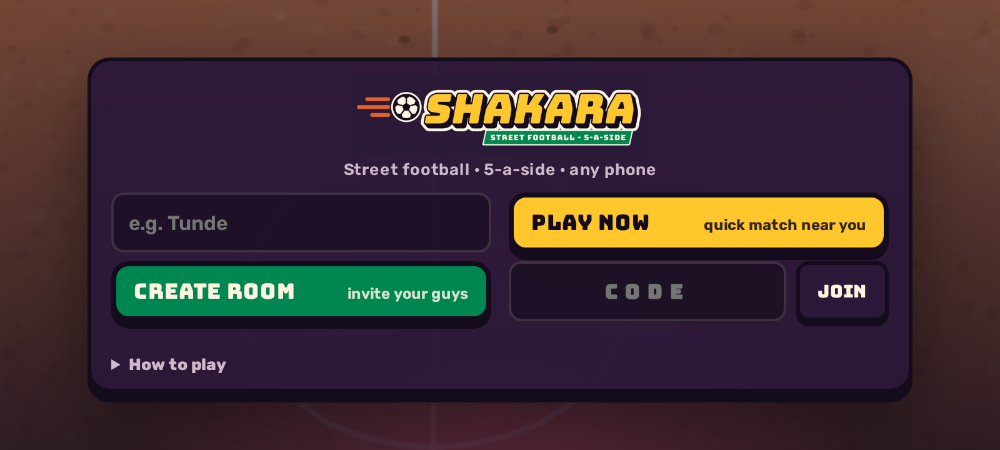
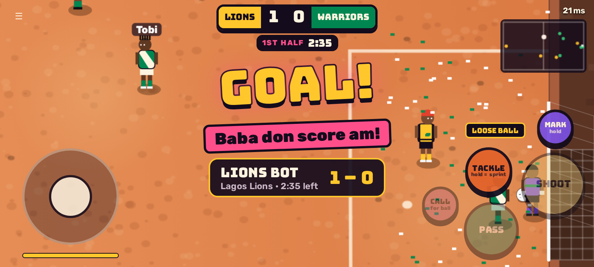

# SHAKARA ⚽ Naija street football, 5-a-side, in the browser

An online multiplayer street-football game for Nigerian players. Friends share a room link on WhatsApp, pick **Lagos Lions** or **Aba Warriors**, and play 5v5 on their phones, with bots filling any empty spot.

**▶ Play the prototype: https://naija5-proto.sites.tab.bot/**

Prototype v0.1 · designed and built by **Olayemi** ([@Jolaolayemi](https://github.com/Jolaolayemi))

<p align="center">
  
  
</p>

## Highlights

- **Made for cheap Android phones on mobile data.** Landscape touch controls, about 100 KB first load, and automatic reconnect that keeps your seat for 25 s if the network drops.
- **Real online play.** A server-authoritative Node + `ws` server simulates at 30 Hz; clients predict, reconcile and interpolate, so it feels right at 150–300 ms ping.
- **Rooms built for WhatsApp.** Create a room, share a `?room=CODE` link, or hit Quick Match to join an open room near you.
- **Street-football feel.** Walls instead of throw-ins, a danfo and kiosks by the pitch, Pidgin commentary on goals ("E don enter!"), and smart controls: hold-to-shoot, **MARK** to shadow your man and **CALL** for the ball.
- **Tiny by design.** All the art is drawn in code on a canvas; no accounts, just a nickname.

## Run locally

Needs Node 18+.

```bash
npm install        # one dependency: ws
npm start          # http://localhost:8080
```

Open two browser tabs, create a room in one and join with the code in the other.

### Configuration

SHAKARA uses **no API keys or secrets**. The only settings are environment variables, both optional; see [`.env.example`](.env.example):

| Variable | Default | What it does |
|---|---|---|
| `PORT` | `8080` | Port the server listens on (most hosts set it for you) |
| `SIM_LAG_MS` | `0` | Fake delay each way for testing, e.g. `SIM_LAG_MS=125 npm start` ≈ 250 ms ping |

Set them in your shell, in a local `.env` (git-ignored), or in your host's dashboard. The same folder runs on any Node host (Railway, Render, Fly.io, a VPS): `npm install && npm start`.

## Architecture

```
browser (public/)                                  server (server/server.js)
┌─────────────────────────────┐   WebSocket /ws   ┌──────────────────────────────────┐
│ main.js                      │ ── input 6 B ──▶ │ rooms: codes, teams, host, quick │
│  • input (touch/keys) 30 Hz  │   (seq, stick,   │   match (region score), reconnect│
│  • prediction + reconcile    │    buttons)      │ per room: Match from sim.js      │
│  • interpolation (~100-300ms)│ ◀─ snapshot ──── │   30 Hz tick: inputs → bots →    │
│  • canvas renderer, camera   │   ~130 B, 15 Hz  │   move → ball → rules → events   │
│  • HUD, lobby, sounds        │ ◀─ JSON events ─ │ static files (gzip, build hash)  │
│ shared/sim.js (movePlayer,   │   lobby, goals,  └──────────────────────────────────┘
│   markInput for prediction)  │   calls, saves
└─────────────────────────────┘
```

- `public/shared/sim.js` holds the rules, with no DOM and no Node APIs, and is imported by both sides. The server runs `Match` for real; the client only uses `movePlayer` and `markInput` to predict its own player.
- Snapshot format (little-endian): `u8 type, u32 tick, u8 state, u8 half, u16 clock*10, u8 scoreA, u8 scoreB, u8 owner, ball i16 x,y,z,vx,vy (cm), u8 n, n × (i16 x,y, u8 face, u8 flags, i16 vx,vy), u16 ackSeq, u8 myIndex, u8 stamina, tackleT, tackleCd, stunT, charge`.
- Input: `u8 2, u16 seq, i8 mx, i8 my, u8 buttons` (PASS 1, SHOOT 2, SPRINT 4, TACKLE 8, MARK 16, CALL 32).
- Server input queue: one input per tick per player, with catch-up when the queue grows, and the last input repeated when it's empty. The ack sequence goes back in each snapshot for reconciliation.

[HOW_IT_WORKS.md](HOW_IT_WORKS.md) is the beginner-friendly version, with diagrams and an "easy edits" table.

## Tests

- `node test/bots.mjs <url> 3 30`: three websocket clients play a full match and check lobby sync, snapshots, MARK, CALL, goals, half time, rematch and reconnect.
- `node test/tune.mjs`: eight bot-only matches at full speed, for balance.
- `node test/screens.mjs <url>` and `node test/latency.mjs`: phone-size screenshots and a fake-ping feel test in headless Chromium (needs `npm i --no-save playwright-core` and a Chromium install).

## More

- [HOW_IT_WORKS.md](HOW_IT_WORKS.md): a plain-language tour with diagrams and an "easy edits" table
- [ROADMAP.md](ROADMAP.md): what comes after v0.1 (regional servers, accounts, scaling)

## Credits

Game design, UX and build: **Olayemi**. Fonts: Bungee and Rubik (SIL Open Font License, see `public/assets`). Networking: [`ws`](https://github.com/websockets/ws).
